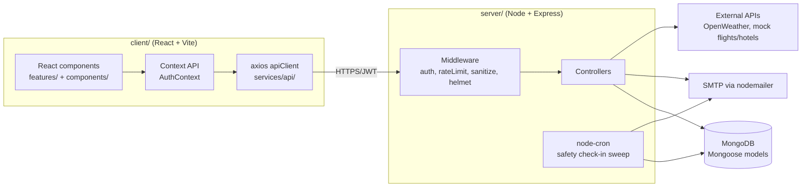
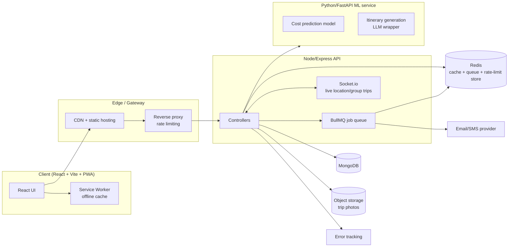

# Architecture

## Current architecture (as of this snapshot of the repo)



**Stack today:** React 18 + Vite + Tailwind (client) · Node + Express 5 +
Mongoose (server) · MongoDB · JWT auth with bcrypt · nodemailer for
transactional email · node-cron for the safety check-in sweep · deployed as
two separate services (client static hosting, e.g. Vercel; server on a
Node host, e.g. Render/Railway) based on the CORS/env setup in `server.js`.

**Honest gaps in the current architecture, not just features:**
- No caching layer — every weather/emergency/visa-style lookup hits the
  external API or the static dataset fresh each time. Fine at current scale,
  won't be once traffic grows.
- The cron sweep runs in-process inside the same Node instance as the API
  server. Works for one instance; breaks (duplicate alerts) the moment you
  run more than one server instance for scaling.
- No object storage for images — `Trip.images` stores URLs, implying
  images are hosted elsewhere already, but there's no upload pipeline in
  this codebase.
- No test suite (`server` test script is a no-op) despite a real CI
  pipeline for lint/format — CI checks style, not correctness.

## Proposed target architecture



**What changes and why — each addition tied to a real need, not added for
its own sake:**

| Addition | Solves | When it's actually needed |
|---|---|---|
| Redis | Cache external-API lookups (weather/visa); shared rate-limit store across instances | As soon as you run >1 server instance, or external API costs/rate limits start to bite |
| BullMQ job queue | Moves the safety-check-in sweep and email sending out of the request/cron path, and makes it safe to run multiple server instances | Before scaling horizontally — the current in-process cron will double-send alerts with 2+ instances |
| Socket.io | Real-time features: live location sharing for the safety feature, group-trip collaborative editing | Only if you build the group-trips or live-location features from FEATURE_IDEAS.md |
| Python/FastAPI ML service | Cost prediction and LLM-based itinerary generation, without forcing Node to do ML work it's not suited for | Only once those specific features are prioritized — don't stand this up speculatively |
| Object storage (S3-compatible) | Real image uploads for trip photos, instead of assuming images are hosted elsewhere | As soon as any feature needs user-uploaded images |
| Sentry (or similar) | Visibility into production errors — currently `console.error` only | Any time before this handles real user traffic; cheap to add now |
| Actual test suite (Jest + Supertest / RTL) | The CI pipeline currently checks style, not correctness | This should honestly come before most of the above — untested code is a worse foundation to build new features on |

## Suggested repo structure additions

```
server/
  services/          # NEW — external API clients (visa, ML service, etc.)
                      #        separated from controllers for testability
  jobs/              # NEW — BullMQ job definitions, replacing ad-hoc cron
  tests/             # NEW — currently doesn't exist at all
client/
  src/
    features/
      groupTrips/    # NEW — if group-trip feature is built
    hooks/           # NEW — shared hooks currently live inline in components
docs/                # NEW — this folder
  ARCHITECTURE.md
  ROADMAP.md
  FEATURE_IDEAS.md
```
